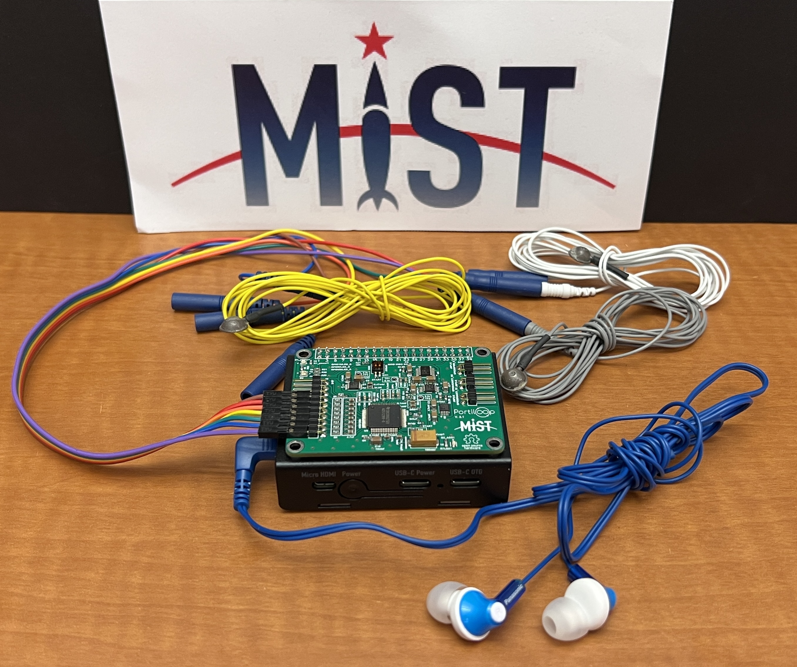
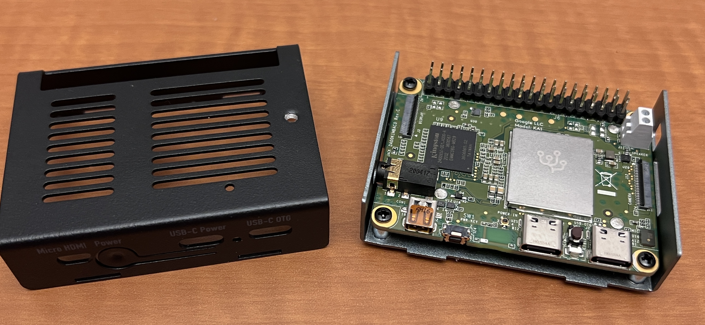
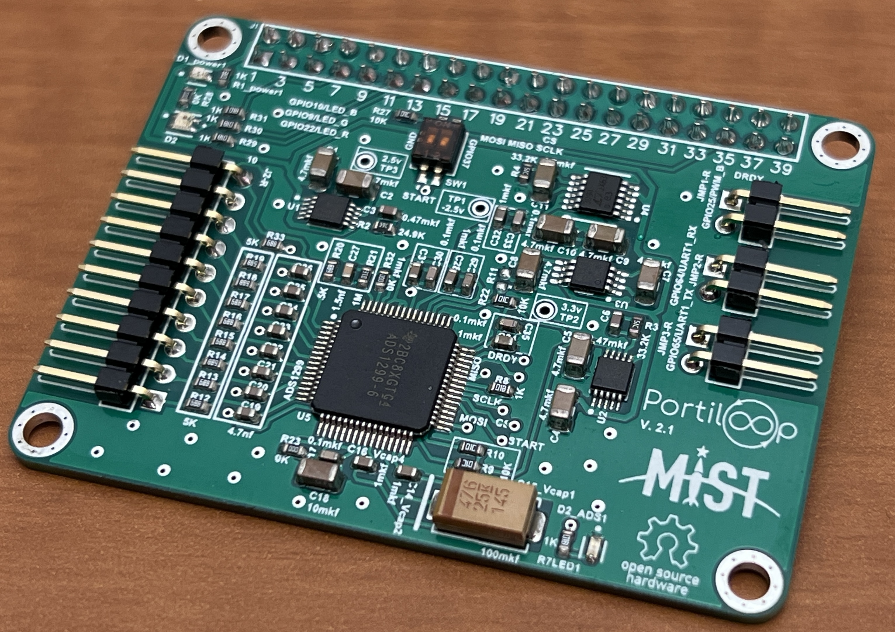
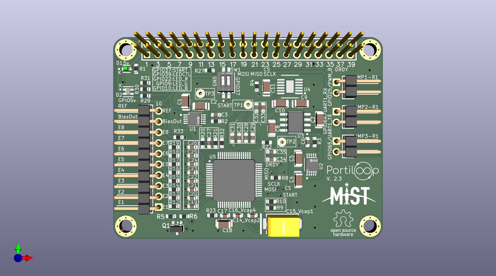
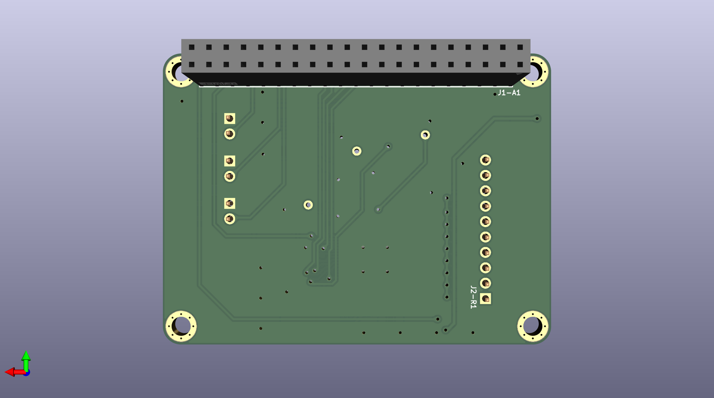
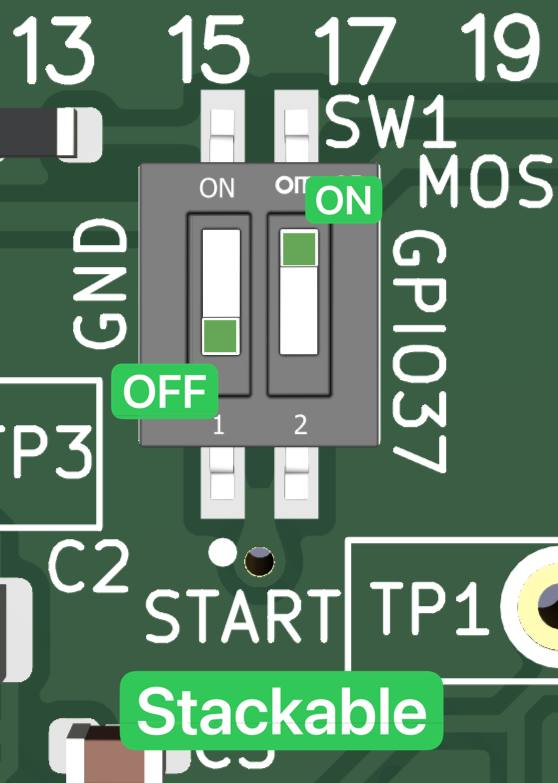
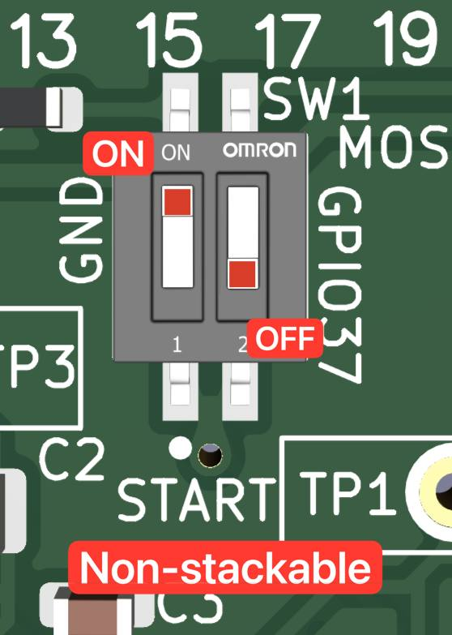
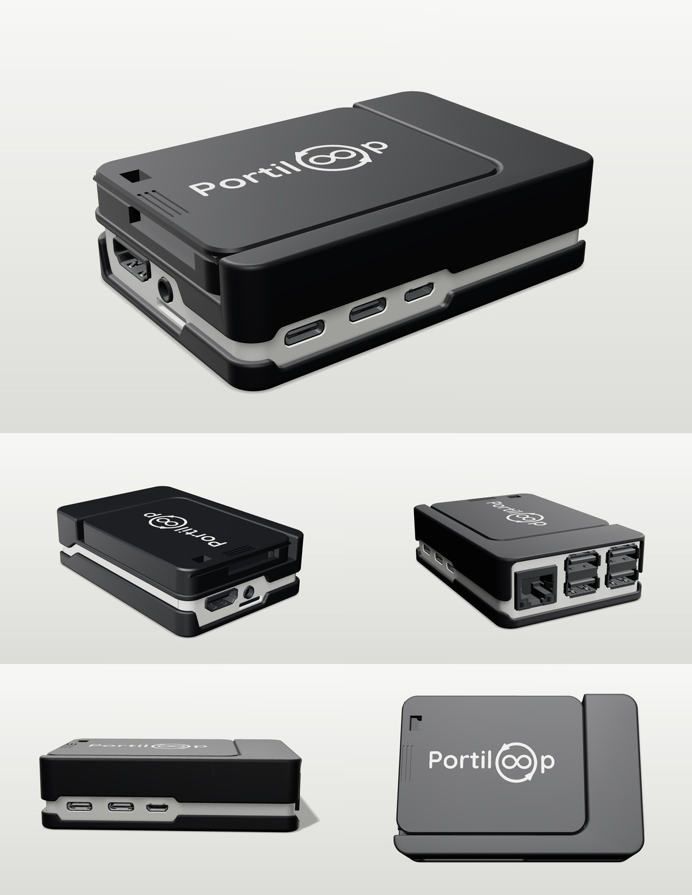
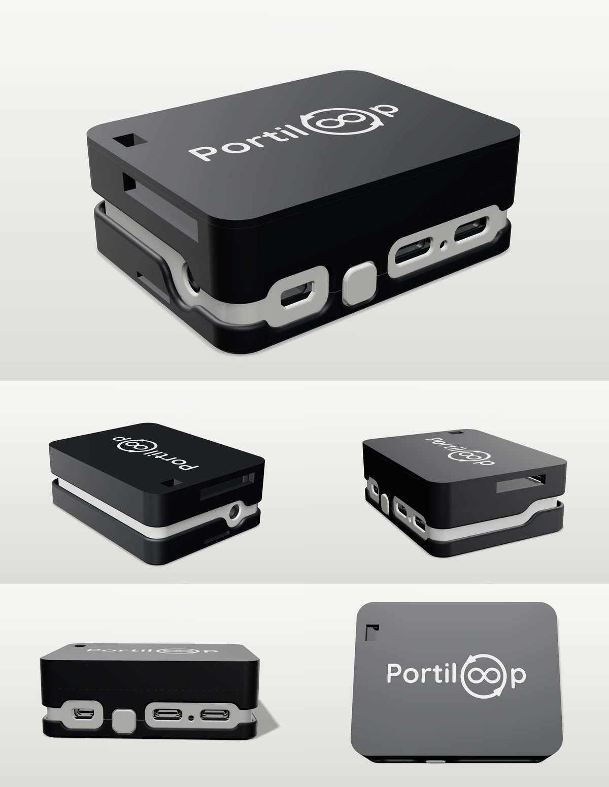
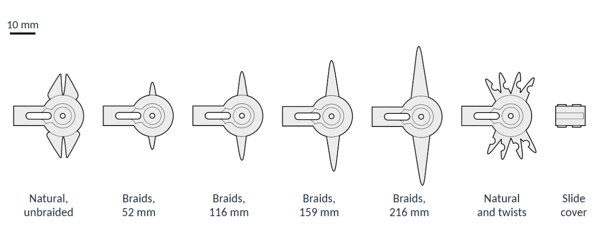

# Portiloop hardware

Hardware design files for the Portiloop, a portable EEG device for closed-loop stimulation. The device is controlled
from a graphical user interface provided by the [Portiloop software](https://github.com/Portiloop/portiloop-software).

## Contents

| Path | Contents |
|---|---|
| `portiloop.kicad_pro`, `portiloop.kicad_sch`, `portiloop.kicad_pcb`, `portiloop.net` | KiCad project: schematic, PCB layout and netlist |
| `Portiloop.kicad_sym`, `Portiloop.pretty/` | KiCad symbol and footprint libraries |
| `fabrication/` | Gerber and drill files |
| `docs/` | Schematic and PCB layout as PDF |
| `models/portiloop.stl` | 3D model of the PCB |
| [`case/`](#case) | 3D-printable cases for Portiloop v2.3 and v3 |
| [`clips/`](#clips) | 3D-printable clips |
| `figures/` | Pictures used in this README |

Two third-party repositories are included as git submodules; clone with `git clone --recursive`.

## PCB

The PCB is built around the [ADS1299](https://www.ti.com/product/ADS1299), an analog-to-digital converter for EEG, and
has connectors for a [Coral Dev Board Mini](https://coral.ai/products/dev-board-mini/#documentation).

  
  

### Stackable and non-stackable modes

Switch SW1 selects the stackable or the non-stackable mode, with the positions shown below. The stackable mode has not
yet been fully tested.

  
  

## Case

3D-printable cases, as 3MF files. Each case has five parts, numbered in the file names: the tray, mid-frame and lid of
the board case (1–3), and the Portiloop box and its lid (4–5).

### Portiloop v3 (D-Robotics RDK X5)

Board: [D-Robotics RDK X5](https://developer.d-robotics.cc/rdk_x_doc/en/07_Advanced_development/01_hardware_development/rdk_x5)

Files: [`case/v3_rdk_x5/`](case/v3_rdk_x5/)

| Part | File |
|---|---|
| Tray | `1_RDK_X5_case_tray.3mf` |
| Mid-frame | `2_RDK_X5_case_midframe.3mf` |
| Lid | `3_RDK_X5_case_lid.3mf` |
| Portiloop box | `4_portiloop_box.3mf` |
| Portiloop lid, with the logo | `5_portiloop_lid_logo.3mf` |

### Portiloop v2.3 (Coral Dev Board Mini)

Board: [Coral Dev Board Mini](https://coral.ai/products/dev-board-mini/#documentation)

Files: [`case/v2.3_coral_mini/`](case/v2.3_coral_mini/)

| Part | File |
|---|---|
| Tray | `1_Coral_mini_case_tray.3mf` |
| Mid-frame | `2_Coral_mini_case_midframe.3mf` |
| Lid | `3_Coral_mini_case_lid.3mf` |
| Portiloop box | `4_portiloop_box.3mf` |
| Portiloop lid | `5_portiloop_lid.3mf` |

The earlier v2.3 box and covers, no longer in use, are archived as STL files in [`case/v2.3_coral_mini/old/`](case/v2.3_coral_mini/old/).

## Clips

Files: [`clips/`](clips/), as 3MF files: clips for different hair types and a slide cover.

| Clip | File |
|---|---|
| Natural, unbraided hair | `natural_unbraided_hair.3mf` |
| Natural hair and twists | `natural_unbraided_hair_twists.3mf` |
| Braids, short prongs | `braids_short_prongs.3mf` |
| Braids, medium prongs | `braids_medium_prongs.3mf` |
| Braids, long prongs | `braids_long_prongs.3mf` |
| Braids, extra-long prongs | `braids_extra_long_prongs.3mf` |
| Slide cover | `slide_cover.3mf` |

## License

The Portiloop hardware design files in this repository are released under the [MIT License](LICENSE). Third-party git submodules keep their own licenses.
